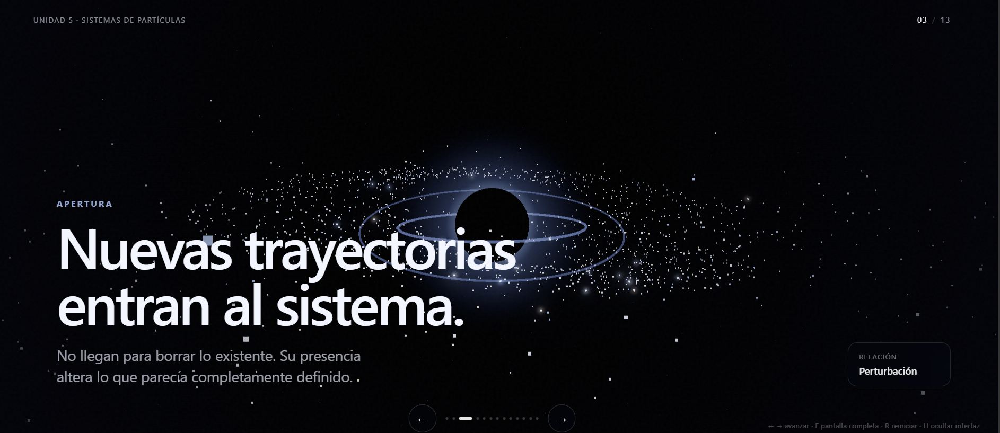
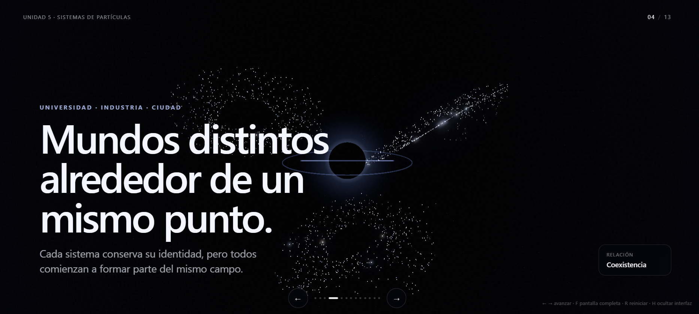
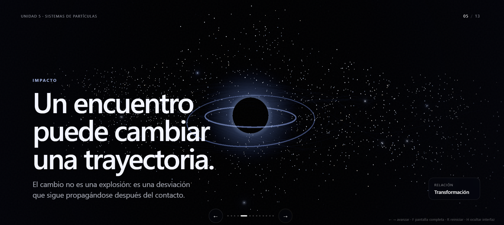
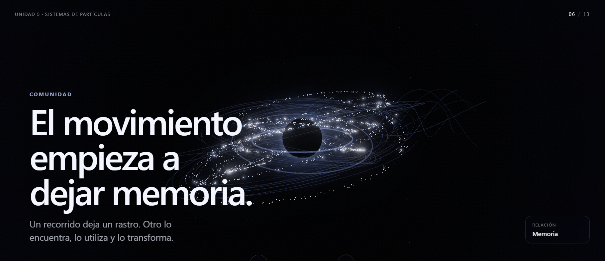
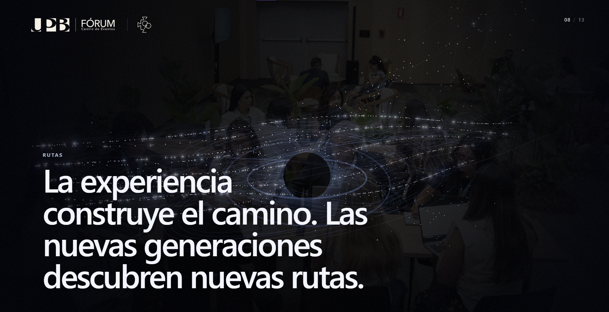
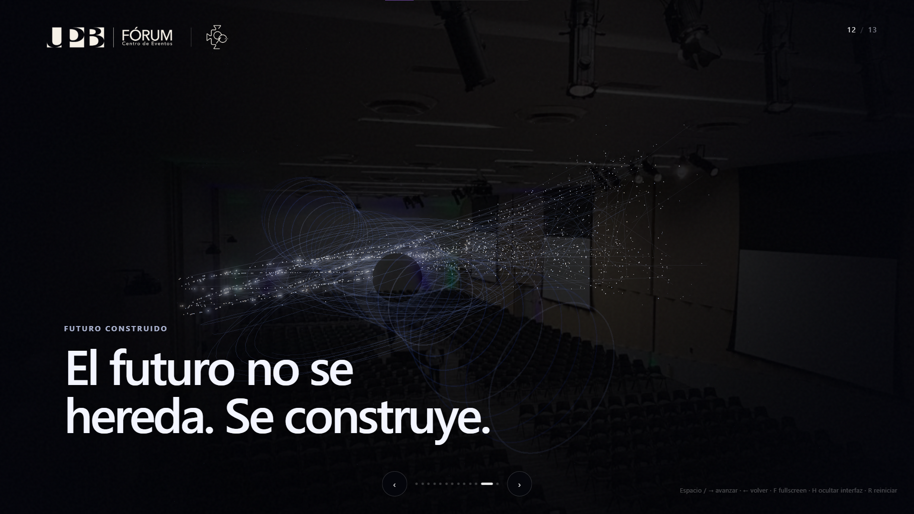
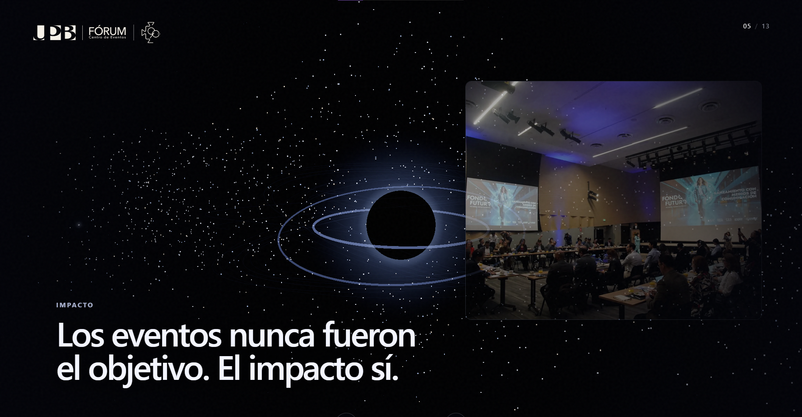
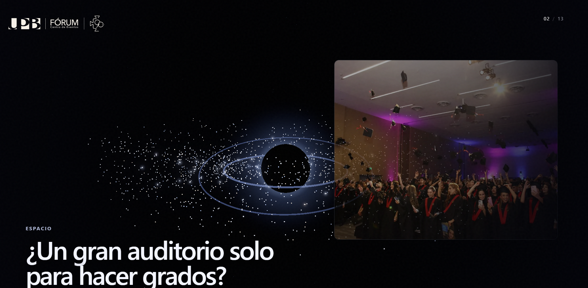

### notas
Estás evidencias son solo pruebas del concepto o storyboard, por ellos los textos son placeholders no son definitvos (No se me puede olvidar cambiarlo)

## BocetoFuncional0.0

|| NO OLVIDAR PONER LAS IMAGENES DEL FORÚM OJO ||

----> FOTOS FORÚM OJO  <----

## BocetoFuncional0.1
Implementación Textos

- Imagenes muy oscuras? pero funcionan creo que se entiende y va de la mano con los agujeros negros y de gusano, pero quita del cento al forum de la u(si yo fuera un cliente no creo q sería bueno,creo)

 
Hice las imagenes un poco más claras pero no se notan las particulas(Creo q mejor las dejo como están, es q daña la narrativa, en mi opinión ps)

## BocetoFuncional0.2
Cambio Estilo Imagenes

-Hice un nuevo boceto para darle más protagonismo a las imagenes y las particulas (Me gusto, se parece una presentación común, pero no me daña la "narrativa")
-Le da más presencía al forúm y no es tan opaco.

